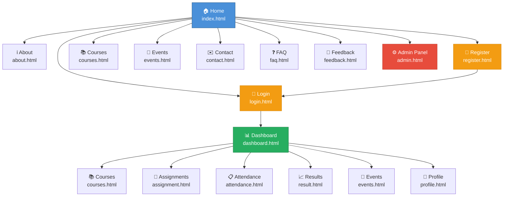

# StudentHub — Sitemap

**Version:** 1.0  
**Last Updated:** July 2026

---

## 1. Visual Sitemap (Mermaid Diagram)



---

## 2. Text-Based Sitemap Tree

```
StudentHub
│
├── 🏠 Home (index.html)
│   │
│   ├── Public Pages
│   │   ├── ℹ️  About (pages/about.html)
│   │   ├── 📚 Courses (pages/courses.html)
│   │   ├── 📅 Events (pages/events.html)
│   │   ├── ✉️  Contact (pages/contact.html)
│   │   ├── ❓ FAQ (pages/faq.html)
│   │   └── 💬 Feedback (pages/feedback.html)
│   │
│   ├── Authentication
│   │   ├── 🔑 Login (pages/login.html)
│   │   └── 📝 Register (pages/register.html)
│   │
│   ├── Student Portal (Authenticated)
│   │   ├── 📊 Dashboard (pages/dashboard.html)
│   │   ├── 📚 Courses (pages/courses.html)
│   │   ├── 📝 Assignments (pages/assignment.html)
│   │   ├── 📋 Attendance (pages/attendance.html)
│   │   ├── 📈 Results (pages/result.html)
│   │   ├── 📅 Events (pages/events.html)
│   │   └── 👤 Profile (pages/profile.html)
│   │
│   └── Administration
│       └── ⚙️  Admin Panel (pages/admin.html)
```

---

## 3. Page Descriptions

| # | Page | URL Path | Purpose |
|---|------|----------|---------|
| 1 | **Home** | `/index.html` | Landing page with hero banner, feature highlights, call-to-action buttons, and quick overview of what StudentHub offers. Serves as the main entry point for all visitors. |
| 2 | **About** | `/pages/about.html` | Information about the StudentHub platform, its mission, the development team, key statistics, and the story behind the project. |
| 3 | **Login** | `/pages/login.html` | Authentication page where registered students and admins enter their credentials (email and password) to access the portal. |
| 4 | **Register** | `/pages/register.html` | Account creation page where new students provide their personal details, student ID, program of study, and set up login credentials. |
| 5 | **Dashboard** | `/pages/dashboard.html` | Personalized student hub displaying academic overview stats (GPA, attendance, assignments), quick links to all portal features, and recent activity feed. |
| 6 | **Courses** | `/pages/courses.html` | Browsable course catalog showing all available courses with details such as instructor, credits, schedule, and enrollment status. Supports filtering and search. |
| 7 | **Assignments** | `/pages/assignment.html` | Assignment tracker listing all current and past assignments with due dates, submission status, course association, and grades for completed work. |
| 8 | **Attendance** | `/pages/attendance.html` | Attendance monitoring page showing per-course attendance records, percentage breakdowns, and color-coded status indicators for each enrolled course. |
| 9 | **Results** | `/pages/result.html` | Grade and result viewing page displaying semester-wise examination results, individual subject grades, semester GPA, and cumulative GPA. |
| 10 | **Events** | `/pages/events.html` | Campus event discovery page listing upcoming events, workshops, seminars, and activities with dates, locations, and registration options. |
| 11 | **Profile** | `/pages/profile.html` | Student profile management page for viewing and editing personal information, contact details, academic summary, and notification preferences. |
| 12 | **Contact** | `/pages/contact.html` | Contact page with a submission form (name, email, subject, message) alongside administration contact details including office hours and location. |
| 13 | **FAQ** | `/pages/faq.html` | Frequently Asked Questions page with categorized, searchable, accordion-style Q&A covering admissions, courses, technical support, and campus life. |
| 14 | **Feedback** | `/pages/feedback.html` | Feedback submission form where students can rate their experience and provide comments about courses, faculty, facilities, or the platform itself. |
| 15 | **Admin Panel** | `/pages/admin.html` | Administrative dashboard for managing users, courses, and events. Includes platform analytics, user tables, and content management tools. |

---

## 4. Page Access Levels

```
┌─────────────────────────────────────────────────────┐
│                   PUBLIC PAGES                       │
│  Home · About · Courses · Events · Contact · FAQ    │
│  Feedback · Login · Register                        │
├─────────────────────────────────────────────────────┤
│               STUDENT PAGES (Auth Required)          │
│  Dashboard · Assignments · Attendance · Results      │
│  Profile                                             │
├─────────────────────────────────────────────────────┤
│               ADMIN PAGES (Admin Role)               │
│  Admin Panel                                         │
└─────────────────────────────────────────────────────┘
```

---

## 5. Navigation Structure

### Primary Navigation (Header)

All pages include the following primary navigation links:

- Home
- About
- Dashboard
- Courses
- Events
- Contact
- FAQ
- Login (button style)
- Register (button style, primary)

### Footer Navigation

The footer is organized into four columns:

1. **Brand** — Logo and description
2. **Quick Links** — Home, About, Courses, Events
3. **Students** — Dashboard, Assignments, Results, Attendance
4. **Support** — Contact, FAQ, Feedback, Admin

---

*Document maintained by the StudentHub Development Team.*
